# building-footprint-benchmark

[](https://github.com/Qandeel-01/digital-building-footprint-identification/actions/workflows/ci.yml)
[](https://github.com/Qandeel-01/digital-building-footprint-identification/actions/workflows/docker-build.yml)
[](LICENSE)

Reproducible harness for benchmarking an open-source building-footprint
detector (AlbuNet / U-Net + ResNet, trained on xBD) across four
SpaceNet 2 regions: **Vegas, Paris, Shanghai, Khartoum**.

> The pipeline runs end-to-end per AOI:
> `bfbench prepare` → `bfbench run-prepared` → `bfbench eval`.
> Every headline number in this README is one row (or an aggregation
> of rows) in a per-AOI Parquet under
> `runs/<slug>_prepare/eval/results.parquet`. Full per-AOI breakdowns
> and stratified CSVs live in [`docs/results.md`](docs/results.md).

## What it does, in one paragraph

The AlbuNet checkpoint that ships with
[rodekruis/automated-building-detection](https://github.com/rodekruis/automated-building-detection)
was trained on xBD imagery at ~0.5 m/px. This project fixes the input
GSD via a mosaic-based adapter, runs the model over a seeded, spatially
deterministic sample of tiles from each of the four SpaceNet 2 AOIs,
and computes per-tile instance-matching metrics (precision / recall /
F1, merge / split rate, boundary Chamfer / Hausdorff) plus
matching-independent metrics (pixel IoU, count error) with an
equal-area CRS assertion running through every area / distance /
density computation. Nothing is quoted anywhere without a Parquet row
behind it.

## Pipeline at a glance

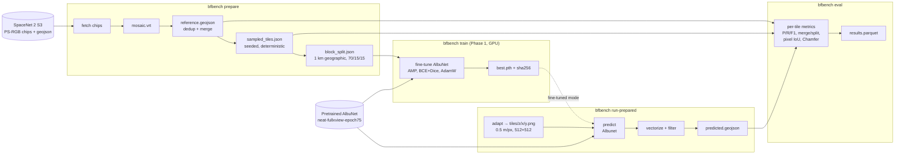

Each box is one stage in `src/bfbench/`; see
[`CONTRIBUTIONS.md`](CONTRIBUTIONS.md) for the file-by-file breakdown.

## Phase roadmap

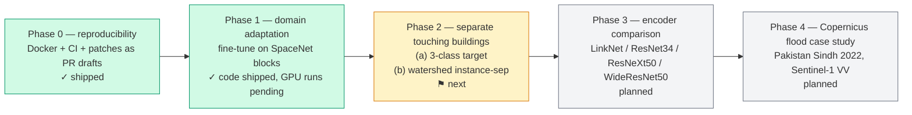

## Results

Micro-averaged precision / recall / F1 across sampled tiles per AOI
(IoU threshold 0.5, 800-chip cluster near AOI centroid, seed
`20260911`). Every number here is regenerable from the corresponding
Parquet via `scripts/aoi_summary.py`. These are **baseline** numbers
(unmodified `neat-fullxview-epoch75` checkpoint); Phase 1 fine-tuned
numbers land in [`docs/results.md`](docs/results.md) after a GPU run.

| AOI            | n_tiles | precision | recall |   F1  | count_ratio | merge_rate | split_rate | pixel_iou_median | Chamfer_median (m) |
|----------------|--------:|----------:|-------:|------:|------------:|-----------:|-----------:|-----------------:|-------------------:|
| AOI_2_Vegas    |      43 |    0.510  | 0.373  | 0.431 |     0.730   |   0.163    |   0.018    |            0.625 |               1.40 |
| AOI_3_Paris    |      64 |    0.290  | 0.272  | 0.281 |     0.938   |   0.049    |   0.005    |            0.462 |               1.43 |
| AOI_4_Shanghai |      32 |    0.211  | 0.139  | 0.167 |     0.656   |   0.129    |   0.010    |            0.314 |               2.31 |
| AOI_5_Khartoum |      18 |    0.259  | 0.143  | 0.184 |     0.550   |   0.190    |   0.020    |            0.439 |               1.70 |

What those numbers say in plain terms: the pretrained model generalises
to Vegas (dense, regular grid, similar to xBD training imagery) at ~43 %
F1 and degrades to ~17 – 18 % in Shanghai (dense informal urban) and
Khartoum (sparse buildings, strong atmospheric haze). With only four
AOIs the Shanghai–Khartoum ordering is well within bootstrap-CI noise;
the headline is that the model degrades most on the AOIs least like
the training distribution, not that it drops in a strict order. Merge
rate rises with building density, which is the direct motivation for
Phase 2's touching-building separation work.

Full per-AOI table, stratified breakdowns and interpretation notes in
[`docs/results.md`](docs/results.md).

### F1 vs local building density (per AOI, 200 m window)

Per-tile F1 binned by the AOI-local reference density (buildings per
hectare in a 200 m window around the tile centroid). 95 % bootstrap
confidence bands per bin.

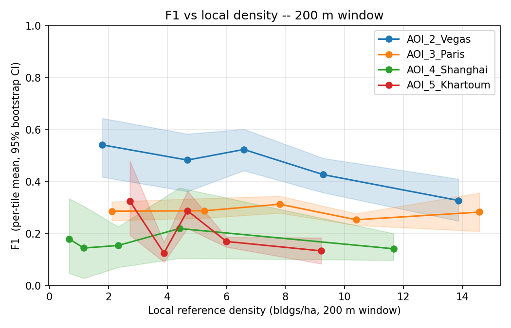

Reading this: Vegas (blue) is roughly flat across density bins — the
model handles both low- and high-density areas comparably. Shanghai
(green) and Khartoum (red) are consistently lower, including in the
lowest-density bins where the "merger" explanation does not apply.
AOI-level performance differences are therefore not reducible to
local density alone; whatever the baseline is missing in those
regions it misses at every density. Phase 1 fine-tuning is the next
step; a Phase 1 overlay version of this figure will land under
`docs/results-figures/` once the GPU runs complete.

<details>
<summary>Density-window robustness (100 m and 500 m)</summary>

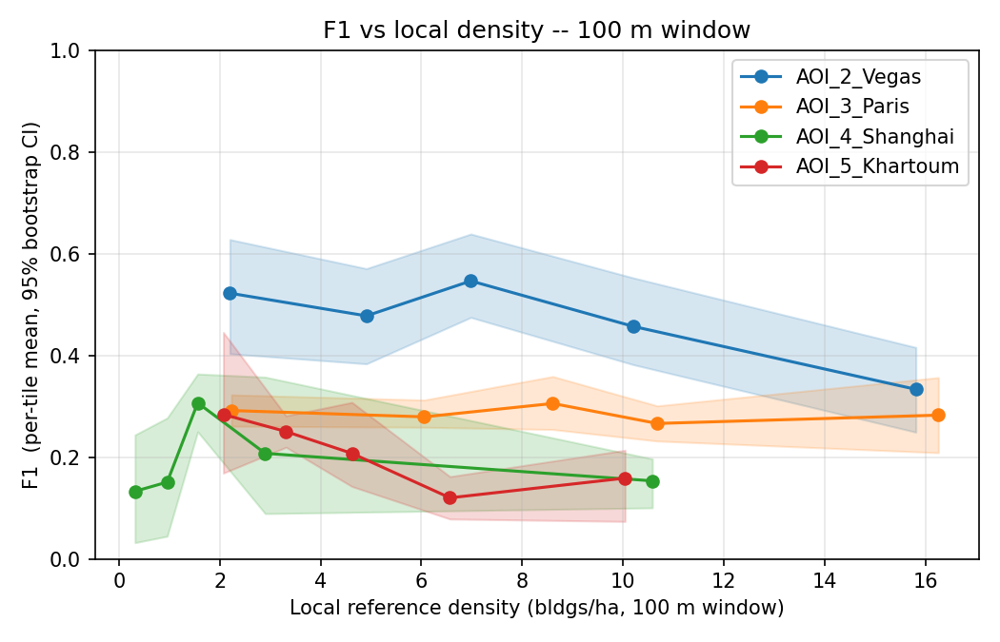
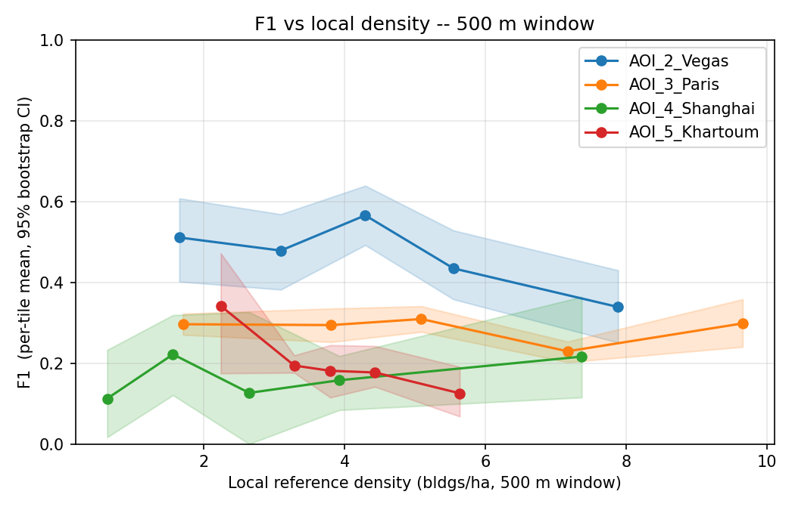

The 100 m window is noisier (fewer buildings per window → higher
sampling variance); the 500 m window washes out intra-AOI gradients
but the AOI-level ordering is identical. 200 m is the default used
by figures and stratified tables for this reason.
</details>

### F1 vs building-size decile

F1 binned by the per-tile median reference building area (m²).

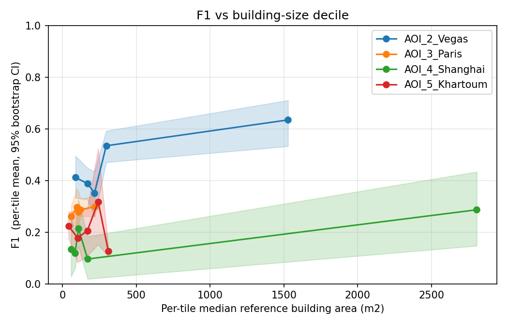

Small-building deciles (left) tie all four AOIs together at low F1 —
the baseline struggles with ≲ 40 m² buildings everywhere. The AOI gap
opens up on medium / large buildings, which is where Vegas's regular
suburban layout plays to the model's training distribution.

### Merge rate vs local density

Merger events (one prediction covering ≥ 2 reference buildings) scale
with local density.

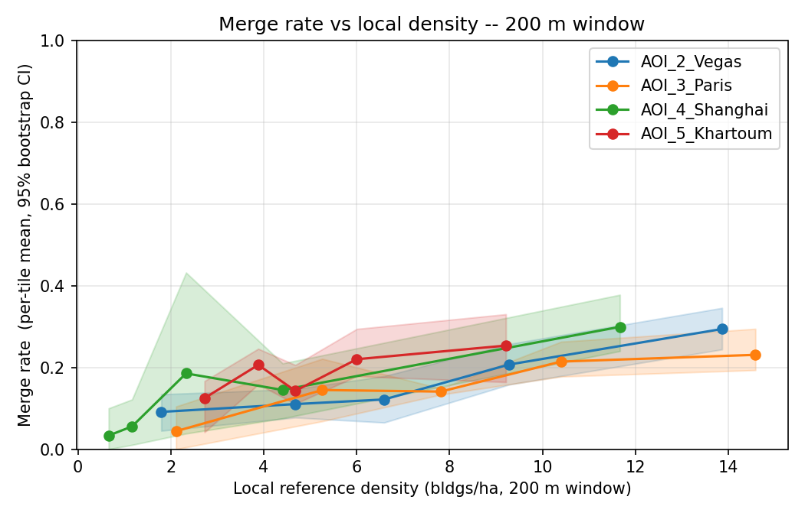

This is the Phase 2 motivation plot: merges rise with density on
every AOI. Phase 2a (3-class training with a border class) and 2b
(watershed instance separation at inference time) both target this
trend directly. The comparison re-plot — baseline / Phase 1 /
Phase 2a / Phase 2b overlaid — is produced after those phases run.

### Qualitative panels (imagery / prediction / reference)

Median and worst tile per AOI ranked by `n_pred / n_ref`. Cyan =
reference. Pink = prediction. Only tile identifiers and polygon
counts appear on the figures.

| Vegas | Paris |
| ----- | ----- |
| 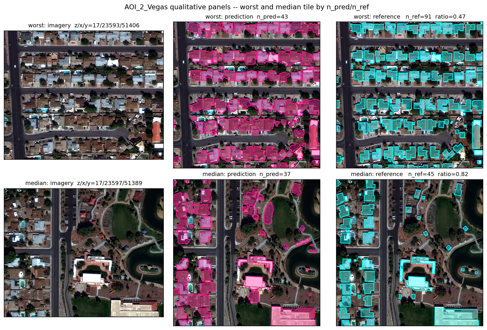 | 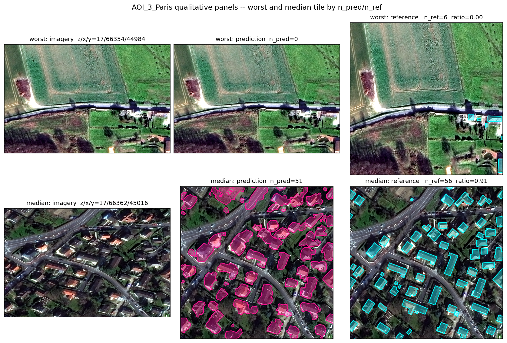 |

| Shanghai | Khartoum |
| -------- | -------- |
| 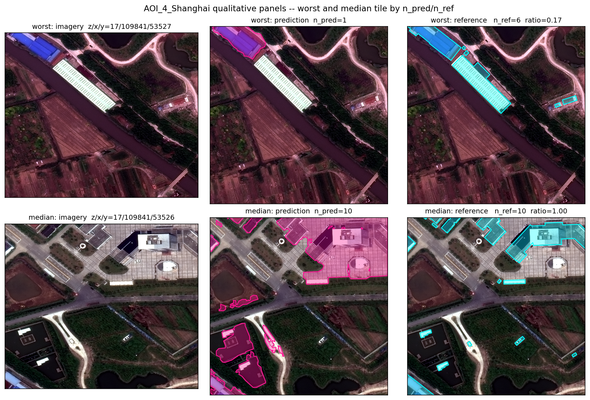 | 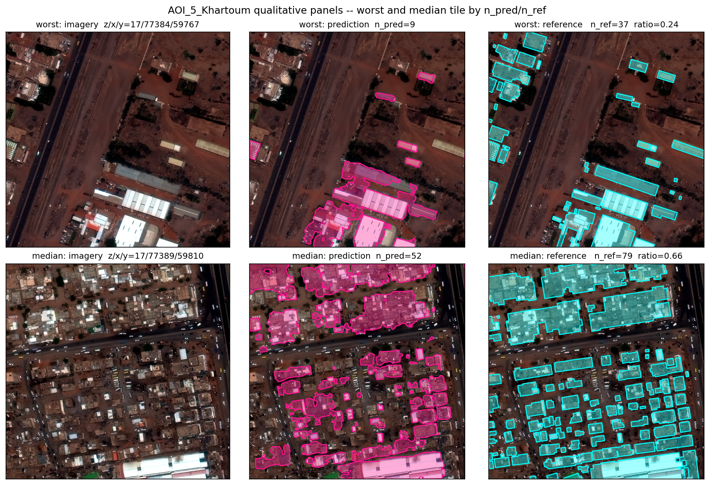 |

What to look at on these: the "worst" column shows the model
consistently merging rows of adjacent dwellings in the dense AOIs,
and dropping thin / long polygons in Khartoum where the training
distribution's rectilinear building prior does not hold.

## Phase 0 — Reproducibility

A deterministic reproduction surface that fits on one laptop and in
one CI job:

- **Dockerfile** at the repo root — `nvidia/cuda:12.8.0-runtime-
  ubuntu22.04` base, miniforge, env from `environment.yml` (no
  duplicated pins), upstream `external/abd` submodule copied in with
  `patches/abd/*.patch` applied via the same `apply_upstream_patches.py`
  script used on the host.
- **`docker-compose.yml`** for the one-AOI smoke stack (10 chips of
  Vegas via `configs/spacenet_vegas_smoke.yaml`), with GPU reservation
  and bind-mounts for `weights/` and `runs/`.
- **`Makefile`** wrappers: `make docker-build`, `make docker-smoke`,
  `make lint`, `make test`.
- **`.github/workflows/docker-build.yml`** — buildx + GitHub Actions
  cache (`type=gha`, `mode=max`). Build-only in CI; no GPU, no
  weights fetch, no SpaceNet download. First build is ~15–25 min;
  subsequent ones reuse the heavy env layer.
- **Five upstream patches** are documented as per-branch PR drafts
  under [`docs/upstream-prs/`](docs/upstream-prs/) with title,
  problem, minimal repro, fix diff, and regression test for each.

Rationale, base-image choice, and limitations are documented in
[`docs/phase0-decisions.md`](docs/phase0-decisions.md). All of this is
covered by `tests/test_dockerfile.py` and
`tests/test_phase0_smoke_assets.py` (18 static assertions that CI
runs on every push).

## Phase 1 — Domain-adaptation fine-tuning

Phase 1 fine-tunes the baseline AlbuNet on SpaceNet 2 training blocks
per AOI (and one pooled model across all four), evaluated on held-out
geographic blocks. Code is shipped; the GPU runs happen on
Kaggle/Colab via [`scripts/kaggle_phase1.py`](scripts/kaggle_phase1.py).

### Geographic block split

Spatially random tile splits leak information: a building that
straddles two adjacent tiles ends up in both train and test. The
split is therefore block-based in an equal-area CRS (EPSG:6933):

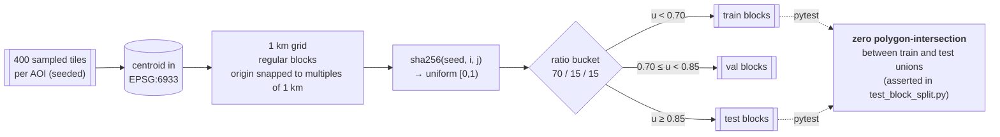

Determinism is pinned by `SplitResult.assignment_hash` (sha256 of the
canonicalised `(i, j, split)` list). Two runs with the same seed and
tile set produce byte-identical splits.

### Training recipe (defaults, overridable in YAML)

| field | default | reasoning |
|---|---|---|
| optimizer | AdamW | adaptive LR tolerates per-AOI dataset-size differences |
| learning rate | 1e-4 | 10× smaller than training-from-scratch; standard for fine-tuning |
| weight decay | 1e-4 | mild; the baseline already generalises |
| scheduler | cosine warm restarts (T₀=5) | lets LR revisit the useful range after plateaus |
| batch size | 4 | 512×512 RGB × fp16 fits in ~10 GB with Albunet |
| epochs | 30 | early-stop on val loss, patience 5 |
| loss | BCE + Dice (0.5 / 0.5) | standard binary-seg baseline |
| mixed precision | fp16 via `torch.amp` | required to fit batch size 4 on 16 GB |
| augmentation | none | fine-tuning gains should come from the SpaceNet domain, not from aug choices |
| seed | 20260911 | same seed used everywhere else in the pipeline |

Full rationale in [`docs/phase1-decisions.md`](docs/phase1-decisions.md).

### What gets reported

Per-AOI (and pooled) comparison tables with 95 % bootstrap CIs on
precision, recall, F1, merge rate, split rate, pixel IoU, Chamfer.
Produced by `scripts/compare_baseline_vs_finetuned.py` after the
Kaggle run. Numbers land in `runs/<aoi>_prepare/eval/comparison_<AOI>.json`
and are rendered into [`docs/results.md`](docs/results.md); the
"typed by hand" path is a hard no.

## Phase 2 — Separating touching buildings (next)

- **(a) 3-class target**: train with `{bg, interior, border}` masks
  where border = pixels inside a building whose nearest *other*
  building boundary is ≤ 3 m. Model's final conv becomes 3-channel
  softmax; CE loss replaces BCE+Dice. Inference extracts the
  interior class and vectorises as today.
- **(b) Watershed instance separation**: pure post-processing on the
  per-tile binary mask. Distance transform → local-maxima markers →
  `skimage.segmentation.watershed`. Drops in behind a
  `postprocess.method: watershed` config flag on `bfbench run-prepared`.
  No retraining; works on top of baseline or Phase 1 checkpoints.

Comparison plot: merge rate vs density (200 m window) overlaid for
baseline / Phase 1 / Phase 2a / Phase 2b. The baseline plot above is
the "before"; the Phase 2 version lands next to it when both runs
complete.

## Provenance

- **What is mine**: everything under `src/bfbench/`, `configs/`,
  `tests/`, `scripts/`, `docs/`, `.github/`, plus the top-level project
  metadata. `LICENSE` is MIT (Copyright 2026 Qandeel Fatima).
- **What is upstream**: `external/abd/` is a git submodule pointing at
  [rodekruis/automated-building-detection](https://github.com/rodekruis/automated-building-detection)
  pinned to commit **`e1668a470b94252040f27d26098826c293fbb46d`**.
  Upstream is MIT-licensed to Ondrej Zacha, Wessel de Jong, Jacopo
  Margutti (Netherlands Red Cross). See
  [`NOTICE`](NOTICE) and [`CONTRIBUTIONS.md`](CONTRIBUTIONS.md).

Nothing in `external/abd/` is authored or modified by this project. It
is installed as a pip-editable dependency at env-setup time.

Five small upstream patches under `patches/abd/` are applied at
setup time; each has been re-verified in isolation (see
[`docs/upstream-prs/`](docs/upstream-prs/) and
`docs/upstream-prs/verification.json`).

## Repro from a clean clone

Two supported paths:

- **Docker (Linux + NVIDIA GPU, one-AOI smoke):** `make docker-build`
  then `make docker-smoke`. The compose stack mounts `weights/` and
  `runs/`, requires a fetched checkpoint and a GPU, and runs
  `bfbench prepare` → `run-prepared` → `eval` on
  `configs/spacenet_vegas_smoke.yaml`. Rationale, base-image choice
  and limitations are documented in
  [`docs/phase0-decisions.md`](docs/phase0-decisions.md).
- **Host (Windows + miniconda3 + NVIDIA GPU, full pipeline):** steps
  below; detailed walk-through in
  [`docs/reproduce.md`](docs/reproduce.md).

Short host-side version:

```powershell
git clone --recurse-submodules `
    https://github.com/Qandeel-01/digital-building-footprint-identification.git `
    building-footprint-benchmark
cd building-footprint-benchmark
conda env create -f environment.yml
conda activate bfbench
python scripts/apply_upstream_patches.py
pip install --no-deps -e ./external/abd/abd_model ./external/abd/abd_utils
pip install --no-deps -e .
python scripts/fetch_weights.py

# Per-AOI slice (Vegas shown; --aoi-id 3, 4, 5 + matching config for
# Paris, Shanghai, Khartoum):
python scripts/select_chips.py --aoi-id 2 --n 800   # pick a compact 800-chip cluster
bfbench prepare configs/spacenet_vegas.yaml         # download + mosaic + dedup + sample
bfbench run-prepared configs/spacenet_vegas.yaml    # adapt + predict + vectorize + filter
bfbench eval configs/spacenet_vegas.yaml            # per-tile metrics -> Parquet
python scripts/aoi_summary.py runs/vegas_prepare/eval/results.parquet `
    --out runs/vegas_prepare/eval/aoi_summary.json  # AOI micro-average P/R/F1
```

Figures are generated via pytest (bare-python matplotlib segfaults on
some Windows GDAL builds; pytest sets up the interpreter differently
and the same code works):

```powershell
pytest tests/test_real_figures_integration.py tests/test_qualitative_panels_all_aois.py
```

For Phase 1 fine-tuning on Kaggle / Colab (GPU required):

```bash
# per AOI (repeat for paris / shanghai / khartoum)
bfbench prepare   configs/spacenet_vegas_phase1.yaml
bfbench run-prepared configs/spacenet_vegas_phase1.yaml --stop-after adapt
bfbench train    configs/spacenet_vegas_phase1.yaml
bfbench run-prepared configs/spacenet_vegas_phase1.yaml
bfbench eval     configs/spacenet_vegas_phase1.yaml

# re-score the baseline on the Phase 1 test blocks (apples-to-apples)
python scripts/kaggle_phase1.py evaluate-baseline-on-phase1-tiles \
    configs/spacenet_vegas_phase1.yaml

# produce the comparison table + markdown
python scripts/kaggle_phase1.py build-comparison \
    configs/spacenet_vegas_phase1.yaml
```

## Design decisions

Written up rather than embedded silently in code:

- [`docs/phase0-decisions.md`](docs/phase0-decisions.md) — Docker base
  image, env.yml reuse, patch-applier placement, CI build-only
  rationale, limitations.
- [`docs/phase1-decisions.md`](docs/phase1-decisions.md) — block
  split, hyperparams, BCE+Dice vs Focal, pooled-val choice, GPU
  runbook.
- [`docs/adapter-decisions.md`](docs/adapter-decisions.md) — GSD
  resampling, tile size, border handling, and the Phase-3 GSD sweep
  (which invalidated the Phase-2 table because that table had been
  run on a chip that was 73 % nodata).
- [`docs/metric-decisions.md`](docs/metric-decisions.md) — the
  Phase-4 spec calls (asymmetric matching invariants, centre-only
  rasterisation default, raster `pixel_iou` interface, required
  `window_m`, densified boundary sampling, and the analytic Chamfer
  correction from 3.125 m → 2.5 m).
- [`docs/phase1-diagnosis.md`](docs/phase1-diagnosis.md) — the
  6-predictions-vs-31-references investigation that led to the
  per-AOI mosaic layer.
- [`docs/reference-data.md`](docs/reference-data.md) — chip-seam
  dedup rule for the reference layer.
- [`docs/environment-notes.md`](docs/environment-notes.md) — every
  deviation from upstream's pinned deps, the Windows / NCCL story,
  the Windows OpenMP note, and the re-pinning procedure.

## Layout

```
building-footprint-benchmark/
├── Dockerfile                 # Phase 0: cuda12.8-runtime + env + abd
├── docker-compose.yml         # one-AOI smoke stack
├── Makefile                   # docker-build / docker-smoke / lint / test
├── external/abd/              # upstream submodule (pinned SHA)
├── src/bfbench/               # this project's code
│   ├── data/                  # SpaceNet fetcher, mosaic, adapter,
│   │                          # dedup, sampling, summary, equal-area,
│   │                          # block_split (Phase 1)
│   ├── metrics/               # instance, pixel, count, boundary,
│   │                          # stratify, bootstrap (Phase 1)
│   ├── train/                 # Phase 1: dataset / loop / manifest
│   ├── train_cli.py           # Phase 1: `bfbench train`
│   ├── prepare.py             # `bfbench prepare`
│   ├── run_prepared.py        # `bfbench run-prepared`
│   ├── eval.py                # `bfbench eval`
│   └── cli.py                 # `bfbench` entry point
├── configs/                   # one YAML per AOI (Phase 2/3 + Phase 1)
├── scripts/                   # chip selection, weight fetch, figures,
│                              # Docker smoke, Kaggle runbook, Phase 1
│                              # comparison, verifier, patch applier
├── tests/                     # ~155 tests: equal-area, metrics, eval,
│                              # block split, bootstrap, training,
│                              # Dockerfile static checks, patch verif
├── docs/                      # decisions, results, upstream PR repros
├── patches/abd/               # five upstream patches
├── .github/workflows/         # ruff + pytest CI, docker-build CI
├── environment.yml
├── pyproject.toml
├── LICENSE                    # MIT, Qandeel Fatima 2026
├── NOTICE                     # upstream attribution
└── CONTRIBUTIONS.md           # file-by-file: mine vs upstream
```

## Reporting rules

Any performance number in this repo must be reproducible from a
specific config + weight checksum + input dataset revision recorded in
the run manifest. Upstream reports IoU 0.79 on xBD; that is their
number on their data and does not appear here as ours.

Equal-area CRS is enforced by assertion (`bfbench.data.equal_area`)
inside every metric that touches area, distance or density. Sampling
is seeded and deterministic: the same config + seed produces
byte-identical tile IDs. Fine-tuned checkpoints ship with a sibling
`.sha256.json` and a `training_manifest.json` recording the full
provenance chain; the manifest writer refuses to write a stale sha.

## License

MIT. See [`LICENSE`](LICENSE) and [`NOTICE`](NOTICE).
