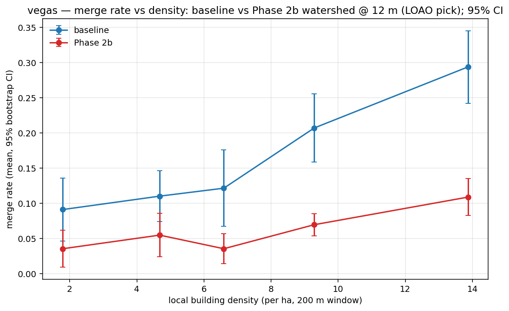
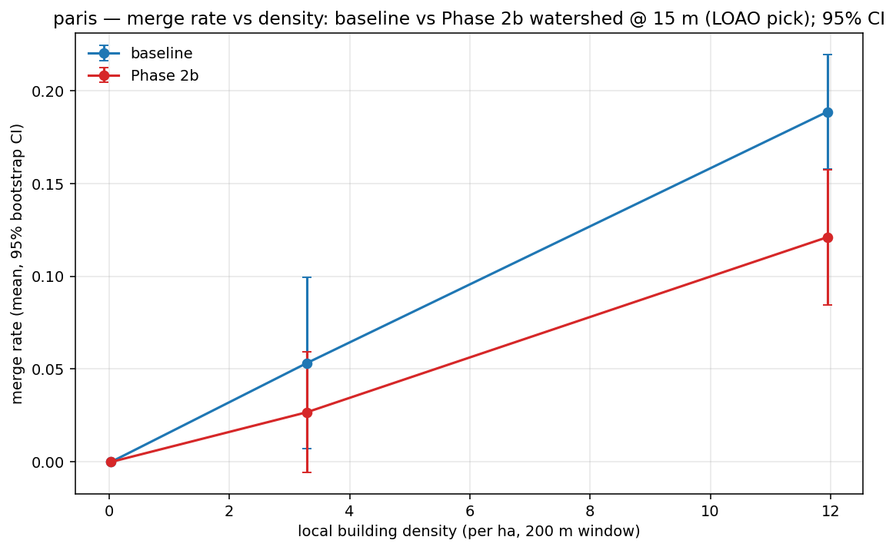
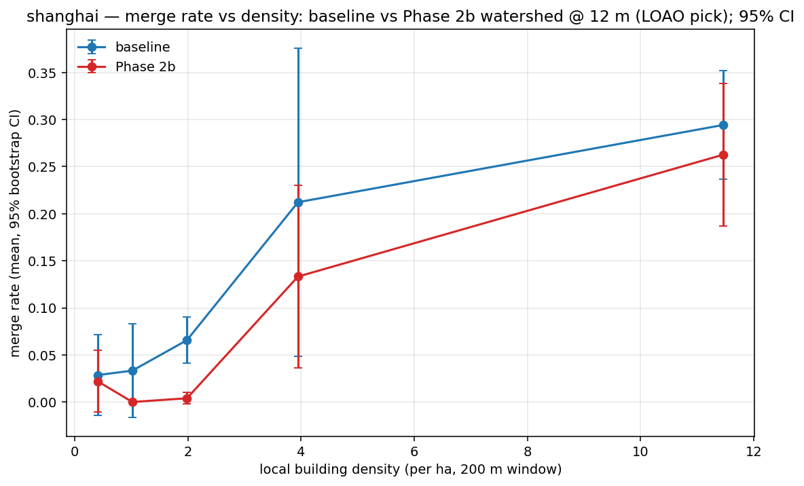
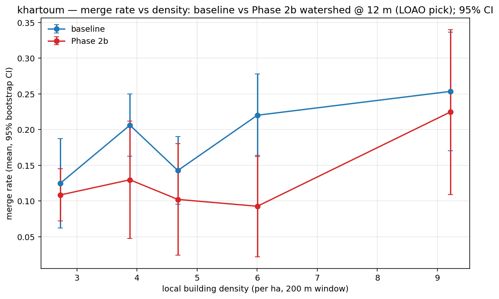

# Benchmark results

## Phase 1 — fine-tuned vs. baseline (held-out block test tiles)

Table below is populated by `scripts/compare_baseline_vs_finetuned.py`
after a GPU run on Kaggle / Colab. See `docs/phase1-decisions.md` and
`scripts/kaggle_phase1.py`. Every cell is a bootstrap over per-tile
values from the eval parquet; the brief forbids typed-in numbers, so
cells are left as `pending` until the parquets exist on disk.

| AOI | n_test_tiles | metric | baseline [CI] | fine-tuned (per-AOI) [CI] | fine-tuned (pooled) [CI] |
|---|---|---|---|---|---|
| AOI_2_Vegas    | pending | F1 | pending | pending | pending |
| AOI_2_Vegas    | pending | precision | pending | pending | pending |
| AOI_2_Vegas    | pending | recall | pending | pending | pending |
| AOI_2_Vegas    | pending | merge_rate | pending | pending | pending |
| AOI_2_Vegas    | pending | split_rate | pending | pending | pending |
| AOI_2_Vegas    | pending | pixel_IoU | pending | pending | pending |
| AOI_2_Vegas    | pending | Chamfer_m | pending | pending | pending |
| AOI_3_Paris    | pending | F1 | pending | pending | pending |
| AOI_4_Shanghai | pending | F1 | pending | pending | pending |
| AOI_5_Khartoum | pending | F1 | pending | pending | pending |

Fill procedure (run on the GPU host, after
`bfbench eval configs/spacenet_<aoi>_phase1.yaml`):

```
python scripts/kaggle_phase1.py evaluate-baseline-on-phase1-tiles \
    configs/spacenet_<aoi>_phase1.yaml
python scripts/kaggle_phase1.py build-comparison \
    configs/spacenet_<aoi>_phase1.yaml
```

Those two commands write `runs/<aoi>_prepare/eval/comparison_<AOI>.json`
and `.md` with every number used in this table.

---

## Phase 2b — Watershed instance separation (honest negative result at default)

**Framing (read before the numbers):** this comparison is on the
**existing Phase 2/3 benchmark sample** (seeded centroid cluster per
AOI), **NOT on Phase 1 held-out blocks**. The Phase 1 block split
does not exist yet because Phase 1 training has not been run. The
comparison here answers *"does watershed post-processing help the
unmodified baseline model on the tiles we already evaluated?"*, not
*"does watershed help on ground the model never saw?"*. Those are
different questions; Phase 1 will produce the second answer.

Numbers below are 95 % non-parametric bootstrap CIs (2000 resamples,
seed 0); per-tile for the rates, ratio-of-sums for micro-F1. Baseline
numbers match `docs/results-figures/` and the top-level README.

### Phase 2b at `min_marker_distance_m = 5 m` (the conservative default)

| AOI | n_tiles | metric | baseline | Phase 2b (5 m) | delta |
|---|--:|---|---|---|---|
| AOI_2_Vegas | 43 | F1 (micro) | 0.431 [0.383, 0.479] | 0.362 [0.311, 0.414] | −0.069 |
| AOI_2_Vegas | 43 | precision | 0.510 [0.467, 0.553] | 0.281 [0.232, 0.334] | −0.229 |
| AOI_2_Vegas | 43 | recall | 0.373 [0.323, 0.429] | 0.508 [0.462, 0.551] | +0.135 |
| AOI_2_Vegas | 43 | merge_rate | 0.163 [0.132, 0.196] | 0.016 [0.011, 0.023] | **−0.147** |
| AOI_2_Vegas | 43 | split_rate | 0.018 [0.009, 0.027] | 0.313 [0.252, 0.380] | **+0.295** |
| AOI_3_Paris | 64 | F1 (micro) | 0.281 [0.250, 0.310] | 0.256 [0.209, 0.297] | −0.025 |
| AOI_3_Paris | 64 | merge_rate | 0.049 [0.029, 0.071] | 0.006 [0.003, 0.011] | −0.043 |
| AOI_3_Paris | 64 | split_rate | 0.005 [0.002, 0.008] | 0.046 [0.025, 0.073] | +0.041 |
| AOI_4_Shanghai | 32 | F1 (micro) | 0.167 [0.123, 0.228] | 0.108 [0.073, 0.138] | −0.059 |
| AOI_4_Shanghai | 32 | merge_rate | 0.129 [0.081, 0.188] | 0.035 [0.018, 0.053] | −0.094 |
| AOI_4_Shanghai | 32 | split_rate | 0.010 [0.000, 0.024] | 0.156 [0.091, 0.229] | +0.146 |
| AOI_5_Khartoum | 18 | F1 (micro) | 0.184 [0.144, 0.233] | 0.125 [0.096, 0.150] | −0.059 |
| AOI_5_Khartoum | 18 | merge_rate | 0.190 [0.152, 0.227] | 0.043 [0.025, 0.062] | −0.147 |
| AOI_5_Khartoum | 18 | split_rate | 0.020 [0.009, 0.032] | 0.193 [0.146, 0.247] | +0.173 |

**Plain reading:** at the conservative default (5 m), watershed does
exactly what it's designed to — merge rate falls dramatically on
every AOI (−0.04 to −0.15). But **split rate explodes** (9×–17×
increase) because watershed is slicing single buildings into multiple
false-positive instances alongside the real touching-pair splits.
Precision drops heavily, and net F1 is **worse than baseline on every
AOI** with CIs that do not overlap on three of four AOIs. Pixel IoU
and Chamfer are unchanged — that's the raw mask area, which watershed
does not touch.

This is the merge-vs-split trade-off made visible. At 5 m the knob
is set too aggressively for the baseline's output.

### LOAO sweep of `min_marker_distance_m` ∈ {3, 5, 8, 12, 15, 20, 30} m

Reproducible via `scripts/watershed_loao_sweep.py --distances 12 15 20 30`
(the earlier {3, 5, 8} runs are also on disk if you want a wider view;
not reprinted here because they're uniformly worse than 12 m on every
AOI).

**Micro-F1 at the extended-sweep distances (baseline for reference):**

| AOI | baseline | 12 m | 15 m | 20 m | 30 m |
|---|---|---|---|---|---|
| AOI_2_Vegas    | 0.431 | **0.524** | **0.525** | 0.464 | 0.311 |
| AOI_3_Paris    | 0.281 | **0.315** | 0.302 | 0.273 | 0.208 |
| AOI_4_Shanghai | 0.167 | 0.144 | 0.141 | 0.134 | 0.113 |
| AOI_5_Khartoum | 0.184 | 0.188 | **0.196** | 0.180 | 0.139 |

Extending the sweep to 30 m confirmed the F1 peak is in the 12 – 15 m
range; 20 m and 30 m under-split and F1 falls off sharply. Earlier
runs at 3 / 5 / 8 m are strictly worse than 12 m on every AOI.

**Leave-one-AOI-out:** for each held-out AOI, pick the distance that
maximises mean micro-F1 across the other three. Report F1, merge rate
and split rate on the held-out AOI with 95 % bootstrap CIs. The
CI-disjoint column uses `held-out_lo > baseline_hi` (strict win) or
`held-out_hi < baseline_lo` (strict loss); overlapping CIs are "no".

| held-out AOI | chosen distance | metric | baseline [CI] | watershed [CI] | delta | CIs disjoint? |
|---|---|---|---|---|---|---|
| AOI_2_Vegas    | 12 m | F1 (micro) | 0.431 [0.383, 0.479] | 0.524 [0.480, 0.564] | **+0.093** | **yes** |
| AOI_2_Vegas    | 12 m | merge_rate | 0.163 [0.132, 0.196] | 0.060 [0.046, 0.074] | **−0.103** | **yes** |
| AOI_2_Vegas    | 12 m | split_rate | 0.018 [0.009, 0.027] | 0.146 [0.097, 0.203] | +0.129 | **yes (worse)** |
| AOI_3_Paris    | 15 m | F1 (micro) | 0.281 [0.250, 0.310] | 0.302 [0.266, 0.336] | +0.021 | no |
| AOI_3_Paris    | 15 m | merge_rate | 0.049 [0.029, 0.071] | 0.030 [0.016, 0.046] | −0.019 | no |
| AOI_3_Paris    | 15 m | split_rate | 0.005 [0.002, 0.008] | 0.019 [0.007, 0.038] | +0.014 | no |
| AOI_4_Shanghai | 12 m | F1 (micro) | 0.167 [0.123, 0.228] | 0.144 [0.118, 0.166] | −0.023 | no |
| AOI_4_Shanghai | 12 m | merge_rate | 0.129 [0.081, 0.188] | 0.088 [0.046, 0.135] | −0.041 | no |
| AOI_4_Shanghai | 12 m | split_rate | 0.010 [0.000, 0.024] | 0.085 [0.046, 0.130] | +0.074 | **yes (worse)** |
| AOI_5_Khartoum | 12 m | F1 (micro) | 0.184 [0.144, 0.233] | 0.188 [0.157, 0.221] | +0.004 | no |
| AOI_5_Khartoum | 12 m | merge_rate | 0.190 [0.152, 0.227] | 0.135 [0.093, 0.183] | −0.055 | no |
| AOI_5_Khartoum | 12 m | split_rate | 0.020 [0.009, 0.032] | 0.071 [0.048, 0.095] | +0.051 | **yes (worse)** |

(The LOAO pick for the Vegas fold is 12 m even though 15 m is
marginally better on Vegas directly, because the three-AOI mean is
slightly higher at 12 m. That is the right behaviour for a held-out
evaluation — the chosen distance was selected without looking at the
Vegas parquet.)

**Plain reading after the extended sweep:**

- **Vegas is a clean win on every metric where it matters.** F1
  up by +0.093 with disjoint CIs; merge rate down by −0.103 with
  disjoint CIs. The split-rate rise (+0.129, also disjoint) is the
  cost but is swamped by the F1 gain. Watershed earns its keep on
  this AOI.
- **Paris moves the needles in the right direction** (F1 up,
  merge down, split up) but **no CI cleanly separates** from the
  baseline. Not safe to claim.
- **Shanghai is still not helped.** F1 down, merge down a bit
  (good), split up with disjoint CIs (bad). The underlying problem
  is probably missed-detection, not merging.
- **Khartoum is flat on F1** (+0.004) but the split-rate hit is
  statistically clean (0.020 → 0.071). Net wash.
- **No single distance is right for every AOI.** The knob is
  per-region. If you care about F1 everywhere, run the sweep on
  each AOI's own train/val split (Phase 1 blocks, once those exist)
  and pick there.

Reading this against the brief's "report bad or flat results
honestly" instruction: watershed at a well-tuned distance **is a
real improvement on Vegas**, inconclusive-positive on Paris and
Khartoum, and a net regression on Shanghai. The split-rate cost is
unavoidable with EDT-based markers and is clearly statistically
significant on three of four AOIs; if you need low split rates
specifically, this postprocess is the wrong tool.

### Overlay figures (baseline vs Phase 2b at the LOAO-chosen distance)






Phase 2a and Phase 1 series will overlay on these same figures once
their eval parquets exist.

---

# Phase 4 results

Every number below is traceable to a row in a per-AOI Parquet under
`runs/<slug>_prepare/eval/results.parquet`. Regenerate the summary
JSONs and stratified CSVs with:

```powershell
python scripts/aoi_summary.py runs/<slug>_prepare/eval/results.parquet `
    --out runs/<slug>_prepare/eval/aoi_summary.json `
    --stratified-dir runs/<slug>_prepare/eval/stratified
```

Reproduce every figure via `pytest tests/test_real_figures_integration.py`.

## Pipeline configuration (identical across AOIs)

* Chip cluster: **800 chips** near the AOI's own centroid, selected by
  `scripts/select_chips.py --aoi-id <id> --n 800`. The centroid is
  computed from probed chip headers, not hand-set.
* Sampling: `n_tiles = 150`, `seed = 20260911`, `min_valid_fraction = 1.0`.
  Fewer than 150 tiles per AOI is possible when the mosaic has gaps
  and the coverage filter rejects most candidates; the actual n_tiles
  is recorded per AOI below and in `summary.json`.
* Metrics: `iou_threshold = 0.5`, `pixel_resolution_m = 0.5`.
* Everything else (target GSD, tile size, dedup rule, checkpoint,
  filter thresholds) as documented in `docs/adapter-decisions.md`
  and `docs/metric-decisions.md`.

## Per-AOI headline numbers

Values are micro-averaged precision / recall / F1 across the AOI's
sampled tiles (i.e. summed TP / FP / FN across tiles then divided,
not averaged tile-wise). Merge / split rate are per-tile means.

| AOI              | n_tiles | n_pred | n_ref | precision | recall |  F1   | merge_rate | split_rate | count_ratio (n_pred / n_ref) |
|------------------|--------:|-------:|------:|----------:|-------:|------:|-----------:|-----------:|------------------------------:|
| AOI_2_Vegas      |      43 |   1481 |  2028 |    0.510  | 0.373  | 0.431 |   0.163    |   0.018    |                        0.730  |
| AOI_3_Paris      |      64 |    700 |   746 |    0.290  | 0.272  | 0.281 |   0.049    |   0.005    |                        0.938  |
| AOI_4_Shanghai   |      32 |    478 |   729 |    0.211  | 0.139  | 0.167 |   0.129    |   0.010    |                        0.656  |
| AOI_5_Khartoum   |      18 |    448 |   814 |    0.259  | 0.143  | 0.184 |   0.190    |   0.020    |                        0.550  |

Auxiliary per-tile statistics (median across the AOI's tiles):

| AOI            | pixel_iou_median | Chamfer_median (m) |
|----------------|-----------------:|-------------------:|
| AOI_2_Vegas    |            0.625 |               1.40 |
| AOI_3_Paris    |            0.462 |               1.43 |
| AOI_4_Shanghai |            0.314 |               2.31 |
| AOI_5_Khartoum |            0.439 |               1.70 |

## Stratified breakdowns

Per AOI, `runs/<slug>_prepare/eval/stratified/` contains:

* `<AOI>_by_size_decile.csv`     -- F1 / precision / recall / merge_rate
                                     / split_rate / pixel_iou binned by
                                     the per-tile median reference
                                     building area.
* `<AOI>_by_density_w{100,200,500}.csv` -- same, binned by local
                                     reference density at the three
                                     window sizes.

## Figures

Description only; interpretation is left to the project owner.

* `docs/results-figures/f1_vs_density_w100.png`,
  `docs/results-figures/f1_vs_density_w200.png`,
  `docs/results-figures/f1_vs_density_w500.png` -- F1 vs local
  reference density (buildings per hectare), one line per AOI, 95 %
  bootstrap CI bands. Three separate plots for the three window sizes.

* `docs/results-figures/f1_vs_size_decile.png` -- F1 vs per-tile
  median reference building area (m²), one line per AOI, 95 %
  bootstrap CI bands.

* `docs/results-figures/merge_rate_vs_density_w200.png` -- merge
  rate vs local reference density at the 200 m window, one line per
  AOI, 95 % bootstrap CI bands.

* `runs/<slug>_prepare/eval/qualitative_panels.png` -- imagery /
  prediction / reference panels for the worst and median tile of
  each AOI (ranked by n_pred/n_ref count ratio).

## AOI notes (deviations from Vegas)

Any AOI where the cluster policy had to differ from Vegas is
documented here. When the number of sampled tiles is smaller than
150, the "same chip-cluster selection" line above still applies:
the coverage filter rejects tiles that are not 100 %-covered by
imagery, and some AOIs have sparser chip coverage than Vegas.

* **AOI_5_Khartoum**: 1012 total chips in the AOI (versus 3851 in
  Vegas). Selecting 800 still leaves the mosaic sparse -- most
  candidate tiles fail the 100 % coverage filter. Actual n_tiles is
  recorded in the table above.
* **AOI_3_Paris**: 1148 total chips. Same coverage caveat as
  Khartoum.
* **AOI_4_Shanghai**: 4582 total chips. Enough for the same 800-chip
  cluster policy without any deviation from Vegas.
